<div align="center">


# Hedge

**Controle financeiro pessoal e compartilhado.**
Saldo real, gastos do mês, cartões e o dinheiro que os outros te devem, no mesmo lugar.

[gethedge.vercel.app](https://gethedge.vercel.app/)

</div>

<br />

<picture>
  <source media="(prefers-color-scheme: light)" srcset="docs/readme/inicio-claro.png" />
  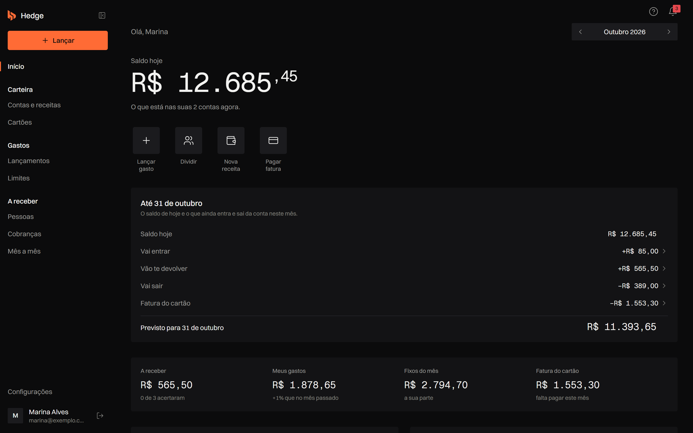
</picture>

## Sobre o projeto

O Hedge responde, em poucos segundos, três perguntas: quanto tenho hoje, quanto vou ter no fim do mês e quanto ainda tenho a receber.

A diferença para um app de controle de gastos comum está na divisão. Um gasto dividido já vira a cobrança de cada pessoa em **A receber**, e o que elas devolvem entra no saldo e na previsão do fim do mês. O app acompanha o dinheiro que saiu inteiro e volta em pedaços.

- Web responsivo, pensado para celular e desktop. Não há app nativo.
- Login com email e senha ou Google. Cada pessoa só vê os próprios dados (Row Level Security no Supabase).
- O saldo parte do que o banco mostra: a conta nasce com o saldo de hoje e o cartão é conferido com o app do banco. Não há integração bancária; tudo é lançado à mão.
- Gratuito e sem anúncios.

Mais contexto de produto (público, princípios, tom de voz) em [`PRODUCT.md`](PRODUCT.md).

## Demonstração

<p align="center">
  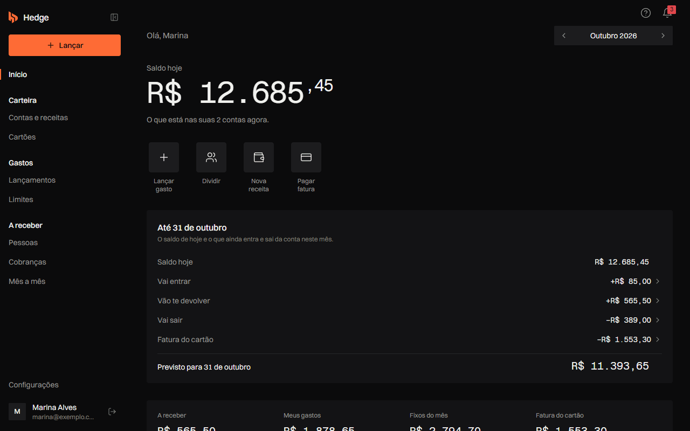
</p>

> Todas as imagens deste README usam uma conta de demonstração com dados fictícios. Nenhum dado de usuário real aparece aqui.

## Funcionalidades

### Início

- **Saldo hoje**: a soma das contas, calculada a partir do histórico (saldo inicial + entradas − saídas), nunca digitada à mão.
- **Previsão do fim do mês**: saldo de hoje mais o que ainda vai entrar, o que vão te devolver, o que vai sair e a fatura do cartão.
- **Confirmação de entradas**: a renda fixa só entra no saldo depois de confirmada ("o salário caiu?"), com registro de adiantamento, atraso ou valor diferente.
- Atalhos para lançar gasto, dividir, registrar receita e pagar fatura.
- Boas-vindas e primeiros passos para quem começa do zero.

### Gastos

<table>
  <tr>
    <td width="50%">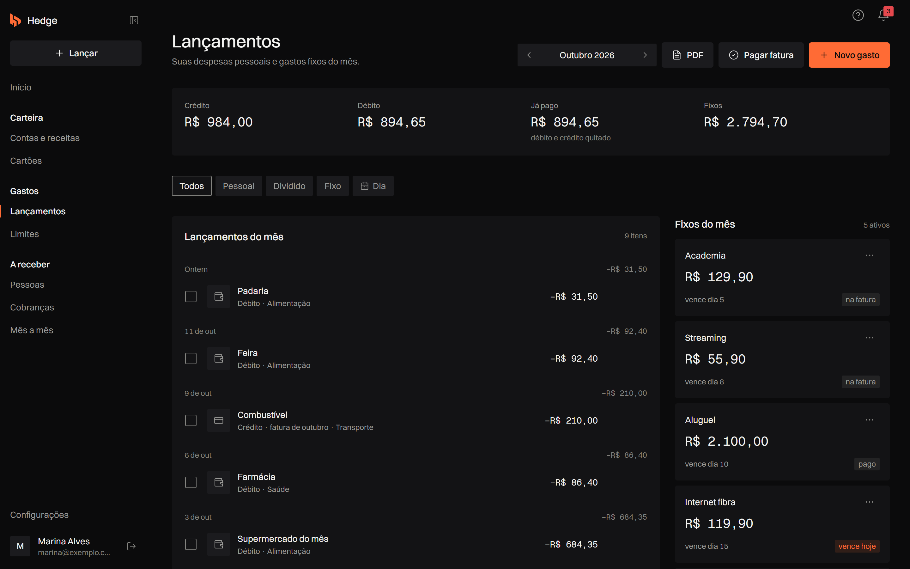</td>
    <td width="50%">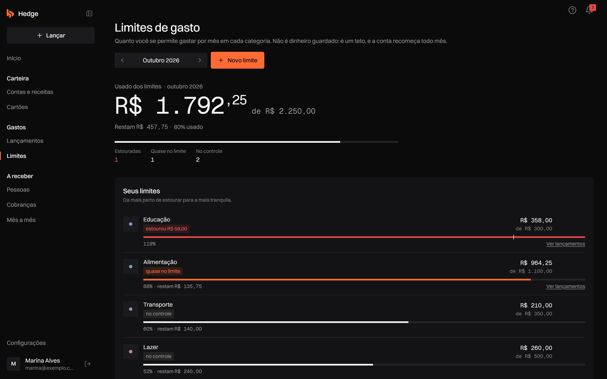</td>
  </tr>
  <tr>
    <td align="center"><sub>Lançamentos</sub></td>
    <td align="center"><sub>Limites de gasto</sub></td>
  </tr>
</table>

- **Lançamentos**: gastos pessoais, divididos e fixos, no débito ou no crédito, parcelados em até 48 vezes. Filtros por tipo e por dia.
- **Gastos fixos**: despesas recorrentes com vencimento, pausa por mês e encerramento sem apagar o histórico.
- **Compra parcelada antiga**: lança só as parcelas que faltam, sem distorcer meses passados.
- **Limites de gasto**: um teto mensal por categoria, com aviso de "quase no limite" e "estourou".
- **Categorias personalizáveis**: oito categorias padrão, curtas e exclusivas; cada pessoa pode criar, renomear e excluir as suas.
- **Relatório em PDF** do mês.

### A receber

<table>
  <tr>
    <td width="50%">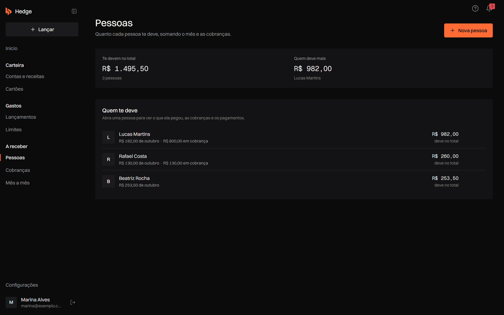</td>
    <td width="50%">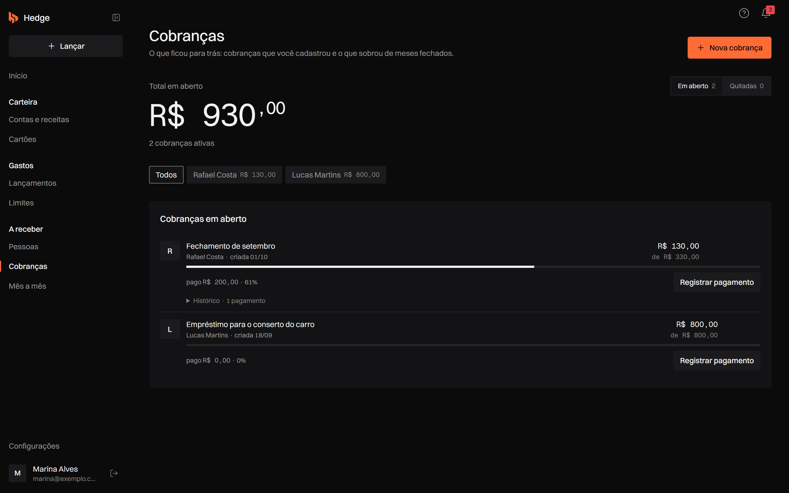</td>
  </tr>
  <tr>
    <td align="center"><sub>Pessoas</sub></td>
    <td align="center"><sub>Cobranças</sub></td>
  </tr>
</table>

- **Pessoas**: quem divide gastos com você e quanto cada uma deve, somando o mês e as cobranças.
- **Do mês**: o que cada pessoa pegou no mês, com fechamento por pessoa; o que não foi pago vira cobrança.
- **Cobranças**: dívidas em aberto, pagamentos parciais, histórico e opção de desfazer um pagamento. O pagamento recebido pode cair numa conta e entrar no saldo.
- Um gasto dividido gera a cobrança automaticamente e fica ligado a ela: editar ou excluir um atualiza o outro.

### Carteira

<table>
  <tr>
    <td width="50%">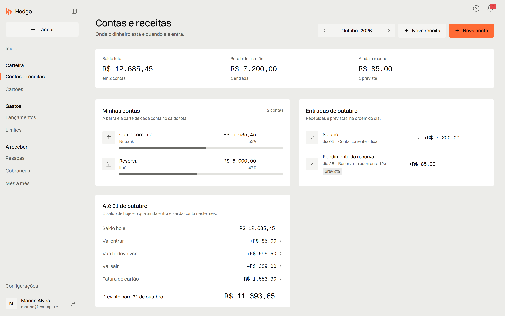</td>
    <td width="50%">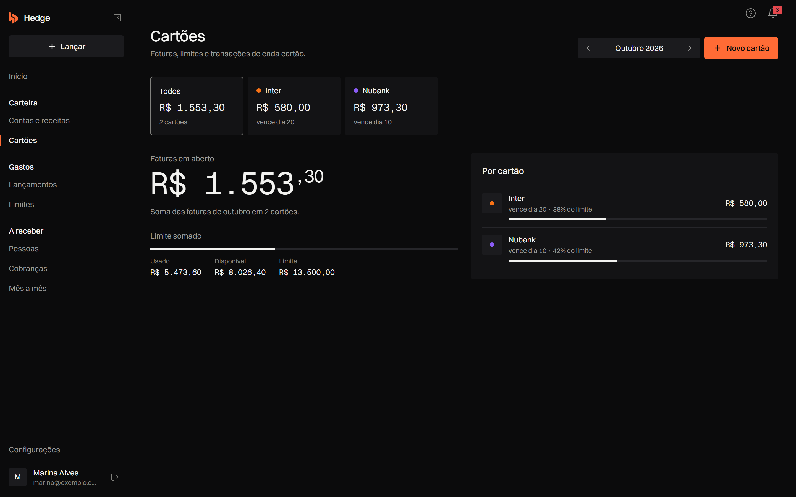</td>
  </tr>
  <tr>
    <td align="center"><sub>Contas e receitas</sub></td>
    <td align="center"><sub>Cartões</sub></td>
  </tr>
</table>

- **Contas e receitas**: saldo por conta, entradas fixas, recorrentes e avulsas, recebidas e previstas.
- **Cartões**: fatura por cartão e por mês, faturas seguintes, limite usado e disponível, pagamento de fatura a partir de uma conta.
- **Conferir com o banco**: o cartão é aberto com o retrato do app do banco (limite disponível e próxima fatura), que substitui a dívida inicial.

### No celular

<table>
  <tr>
    <td width="25%">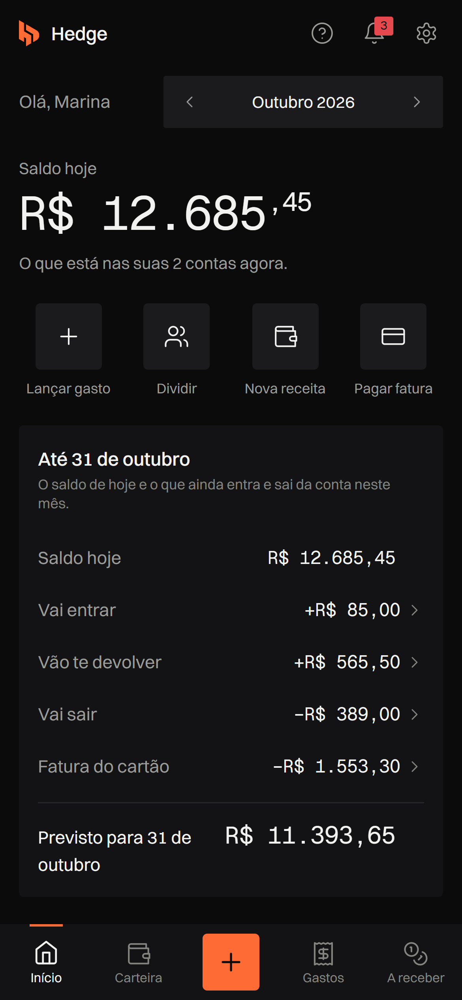</td>
    <td width="25%">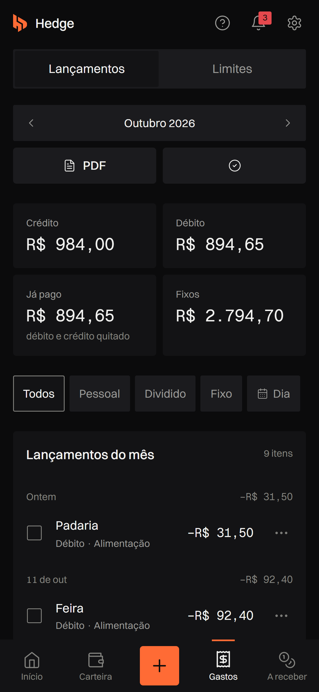</td>
    <td width="25%">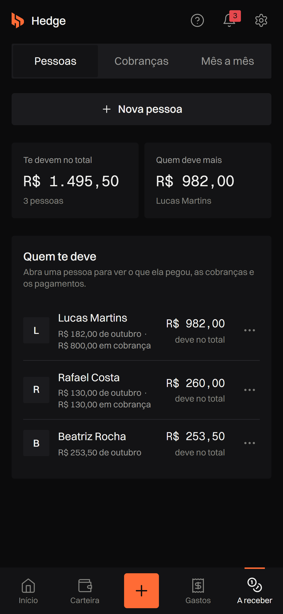</td>
    <td width="25%">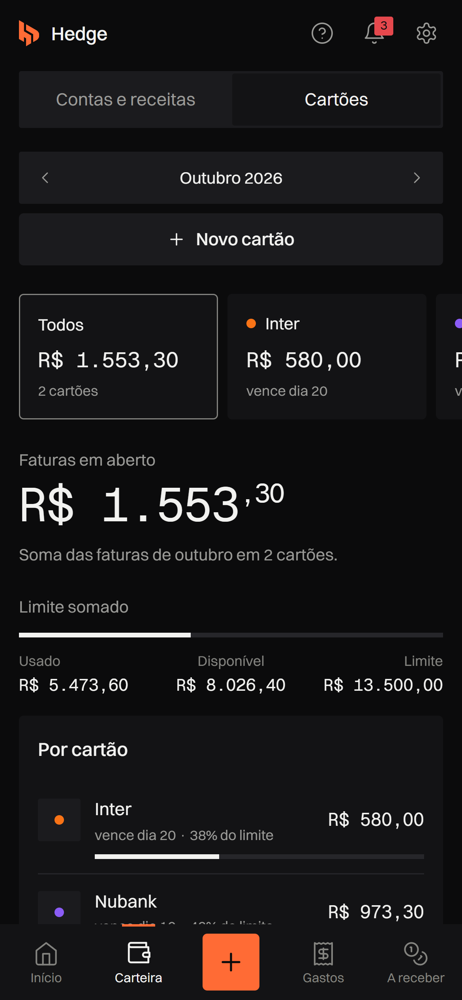</td>
  </tr>
</table>

Barra de navegação inferior, botão de lançamento sempre à mão e formulários em folha que sobe da base da tela.

### Configurações e administração

- Nome, tema claro ou escuro, categorias, notificações push.
- **Zerar dados**: recomeça do zero mantendo a conta.
- **Excluir conta**: apaga a conta e todos os dados associados.
- **Admin**: papéis de usuário, contas ativas e funcionalidades habilitadas por usuário (feature flags), registro de atividade e encerramento de sessões.

### Landing page

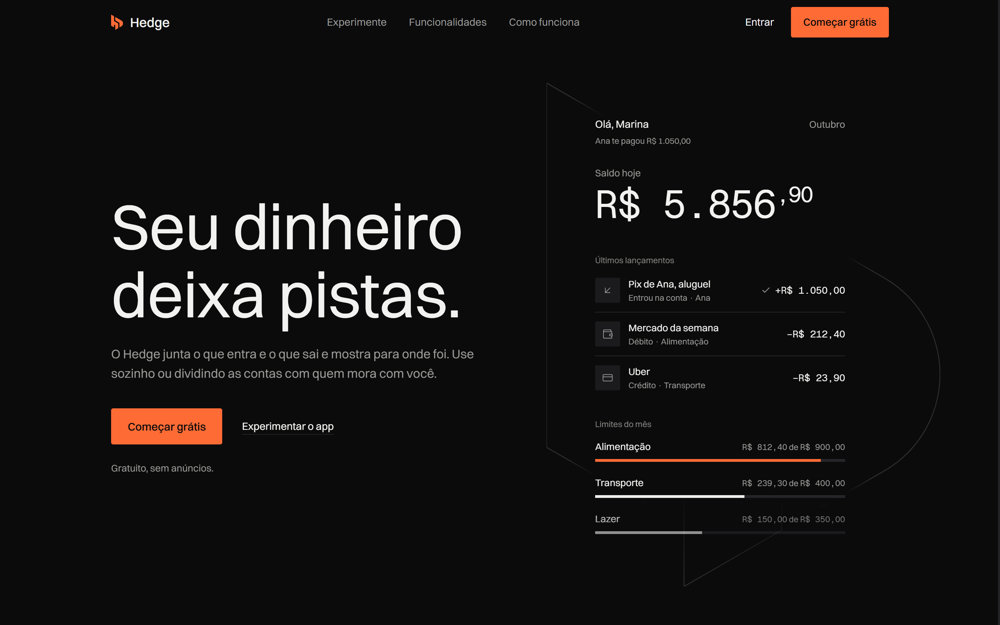

Página pública com demonstração interativa do app (dados de exemplo, sem conta), animações ligadas à rolagem e QR code para abrir o site em outro aparelho.

## Tecnologias Utilizadas

| Camada | Ferramentas |
| --- | --- |
| Interface | React 18, React Router 7, TypeScript |
| Build | Vite 5 |
| Estilo | Tailwind CSS 3, tipografia Switzer (texto) e Geist Mono (valores) |
| Dados e autenticação | Supabase (Postgres, Auth, Row Level Security, Edge Functions) |
| Gráficos | Recharts |
| Relatórios | jsPDF e jspdf-autotable |
| Animação (landing) | GSAP e Lenis |
| Utilitários | date-fns, lucide-react, qrcode-generator, web-vitals |
| Testes | Vitest e Testing Library (regras de dinheiro), Playwright (E2E) |
| Hospedagem | Vercel |

## Instalação

### Pré-requisitos

- Node.js 18 ou superior (o CI usa Node 22)
- npm
- Um projeto Supabase. O app não funciona sem ele; ver [Banco de dados](#banco-de-dados).

### Passos

1. **Clone o repositório**

```bash
git clone https://github.com/georgepxto/gestaofinanceira.git
cd gestaofinanceira
```

2. **Instale as dependências**

```bash
npm install
```

3. **Configure as variáveis de ambiente**

Copie `.env.local.example` para `.env.local` e preencha:

```env
VITE_SUPABASE_URL=https://seu-projeto.supabase.co
VITE_SUPABASE_ANON_KEY=sua-chave-anonima

# Opcional: login com Google sem redirecionamento
VITE_GOOGLE_CLIENT_ID=seu-client-id.apps.googleusercontent.com
```

Sem `VITE_SUPABASE_URL` e `VITE_SUPABASE_ANON_KEY` o app mostra a tela "Configuração Necessária" e não carrega. O `.env.local` está no `.gitignore` e nunca deve ser commitado.

4. **Inicie o servidor de desenvolvimento**

```bash
npm run dev
```

## Banco de dados

Autenticação, dados e Row Level Security vivem no Supabase. Todas as tabelas têm RLS ativa: cada usuário só lê e escreve o que é seu.

| Arquivo | Conteúdo |
| --- | --- |
| `supabase/base/supabase_schema.sql` | Schema principal: gastos, pessoas, cobranças, contas, cartões, receitas, limites, categorias |
| `supabase/base/supabase_admin_schema.sql`, `supabase_admin_v2.sql` | Papéis de usuário e feature flags usados pelo Admin |
| `supabase/base/supabase_web_vitals.sql` | Tabela de Core Web Vitals (opcional) |
| `supabase/migrations/` | Migrações incrementais, aplicadas em ordem cronológica pelo nome |
| `supabase/base/schema_atual.sql` | Retrato do schema como está no banco, gerado por `scripts/gerar-schema.py`. É referência, não é para rodar |

Para um projeto novo: rode os arquivos de `supabase/base/` (nas versões `_v2` e `fix_*` mais recentes) e depois as migrações de `supabase/migrations/` em ordem. Consolidar tudo num histórico único de migrações é uma pendência conhecida.

### Edge Functions

| Função | Uso |
| --- | --- |
| `send-push-notifications` | Envia as notificações push. Exige o segredo `PUSH_CRON_SECRET` |
| `collect-web-vitals` | Recebe as métricas de Core Web Vitals do cliente |
| `admin-force-logout` | Encerra as sessões de um usuário; só aceita chamadas de um admin autenticado |

Segredo da função de push:

```bash
supabase secrets set PUSH_CRON_SECRET="<seu-segredo-forte>"
```

Ao invocar a função (cron ou manual), envie um destes headers:

- `Authorization: Bearer <seu-segredo-forte>`
- `x-cron-secret: <seu-segredo-forte>`

As chaves privadas (service role, VAPID, segredos de cron) ficam só nos segredos do Supabase e do GitHub Actions, nunca no código.

## Estrutura do Projeto

```
src/
├── App.tsx               # Rotas, portões de auth e feature flags, splash de boot
├── main.tsx              # Entry point
├── index.css             # Estilos globais e tokens de design
├── context/              # Estado realmente compartilhado (mês em visualização, pessoas, modais)
├── hooks/                # Um hook por domínio (useMeusGastos, useCartoes, useContasBancarias,
│                         # useSaldosDevedores, useCategorias, useFeatureFlags, useAuth, ...)
├── lib/
│   └── supabase.ts       # Cliente Supabase e acesso a dados por domínio
├── pages/                # Uma página por rota (Dashboard, Eu, Metas, Pessoas, Dividas,
│                         # Gastos, ContasBancarias, CartoesCredito, Configuracoes, Admin, Landing)
├── components/
│   ├── landing/          # Landing page e demonstração interativa
│   ├── layout/           # Sidebar, barra inferior, Layout, sino de notificações
│   ├── modals/           # Formulários e confirmações
│   ├── entradas/         # Confirmação de receitas ("o salário caiu?")
│   ├── cartoes/          # Conferência do cartão com o banco
│   ├── receber/          # Registro de pagamentos recebidos
│   ├── onboarding/       # Boas-vindas e primeiros passos
│   └── ui/               # Primitivos (Card, Valor, PageHeader, AsyncState, Toaster, ...)
├── types/                # Tipos TypeScript
└── utils/                # Regras de dinheiro: saldo, previsão, fatura, parcelas, receitas, PDF
```

### Arquitetura

- **Quatro áreas com sub-navegação**: Início, Gastos (Lançamentos, Limites), A receber (Pessoas, Cobranças, Do mês) e Carteira (Contas, Cartões).
- **Estado por domínio em hooks**, não num componente central. Cada página consome os hooks de que precisa.
- **Regras de dinheiro em funções puras** (`src/utils`): saldo, previsão do fim do mês, fatura e parcelas são calculados do histórico e cobertos por testes.
- **Rotas carregadas sob demanda** com `React.lazy`; a casca e o Início são pré-carregados durante a verificação de sessão.
- **Feature flags por usuário** definem quais rotas existem para cada conta, geridas no Admin.

## Design

Sistema visual escuro por padrão, com tema claro completo e um único acento laranja (`#FF6B35`) para a ação principal e para o que pede atenção. Entrada e saída se distinguem pelo sinal, não pela cor. Valores em Geist Mono, texto em Switzer.

O sistema está documentado em [`DESIGN.md`](DESIGN.md). Um script de guarda (`npm run check:ds`, rodado antes do build e no CI) procura violações do sistema visual, como cores fora da paleta ou texto sem par para o tema claro.

## Segurança e Privacidade

- **Row Level Security** em todas as tabelas; políticas por `user_id`.
- **Somente a chave anônima** do Supabase vai para o cliente. A service role existe só dentro das Edge Functions.
- **Bloqueio de tentativas de login** por email, registrado no banco.
- **Nada sensível no navegador**: listas locais de versões antigas são apagadas ao iniciar e no logout.
- **Exclusão de conta** remove todos os dados do usuário.
- **Segredos fora do repositório**: `.env.local`, chaves VAPID e artefatos de teste estão no `.gitignore`; o CI lê credenciais dos segredos do GitHub.

## Performance em Produção

### Metas de Core Web Vitals

| Métrica | Meta |
| --- | --- |
| LCP | até 2500 ms |
| INP | até 200 ms |
| CLS | até 0,1 |

### Como medir

O app registra LCP, INP e CLS no cliente e mostra os valores no console com o prefixo `[web-vitals]`. Com `VITE_WEB_VITALS_ENDPOINT` definido, os dados também são enviados por `sendBeacon`.

Para coletar no Supabase:

1. Rode `supabase/base/supabase_web_vitals.sql` no SQL Editor.
2. Publique a função:

```bash
supabase functions deploy collect-web-vitals
```

3. Aponte o endpoint para ela:

```env
VITE_WEB_VITALS_ENDPOINT=https://<seu-projeto>.supabase.co/functions/v1/collect-web-vitals
```

4. Consulte:

```sql
select metric, page_path, value, rating, status, collected_at
from public.web_vitals_metrics
order by collected_at desc
limit 100;
```

## Scripts Disponíveis

```bash
npm run dev              # Servidor de desenvolvimento
npm run build            # Guarda de design + checagem de tipos + build de produção
npm run preview          # Preview do build
npm run lint             # ESLint
npm run check:ds         # Guarda do sistema visual, sem build
npm test                 # Testes unitários (Vitest) das regras de dinheiro

npm run test:e2e         # Testes E2E (Playwright)
npm run test:e2e:headed  # E2E com navegador visível
npm run test:e2e:ui      # E2E no modo interativo
```

## Testes

### Unitários (Vitest)

`src/utils/regras.test.ts` cobre as regras de dinheiro: saldo calculado do histórico, previsão do fim do mês, fatura do cartão, parcelas, divisão da minha parte e formatação de valores.

### E2E (Playwright)

- **Telas públicas** (`tests/e2e/public-visual.spec.ts`): landing e login. Não entram em conta nenhuma e não gravam nada.
- **Telas logadas** (`tests/e2e/logado.spec.ts`): entram numa conta que existe só para teste, abrem todas as áreas e lançam, editam, dividem e excluem gastos. Tudo o que é criado se chama `[TESTE] ...` e é apagado no fim. Sem as credenciais no ambiente, o teste é pulado.

```bash
E2E_EMAIL="conta-de-teste@exemplo.com" E2E_PASSWORD="..." npm run test:e2e
npx playwright show-report
```

Nunca use uma conta pessoal: o teste grava e apaga dados.

### Integração contínua

A cada pull request e push na `main`, o GitHub Actions roda: guarda de design, lint, testes unitários, build, telas públicas e, quando os segredos `E2E_EMAIL`, `E2E_PASSWORD`, `VITE_SUPABASE_URL` e `VITE_SUPABASE_ANON_KEY` estão cadastrados, as telas logadas.

## Licença

Projeto de uso pessoal. Todos os direitos reservados.

## Autores

- **George**: [github.com/georgepxto](https://github.com/georgepxto)
- **Samuel Sousa** (coautor): [github.com/SamuelSousaDEV](https://github.com/SamuelSousaDEV)
